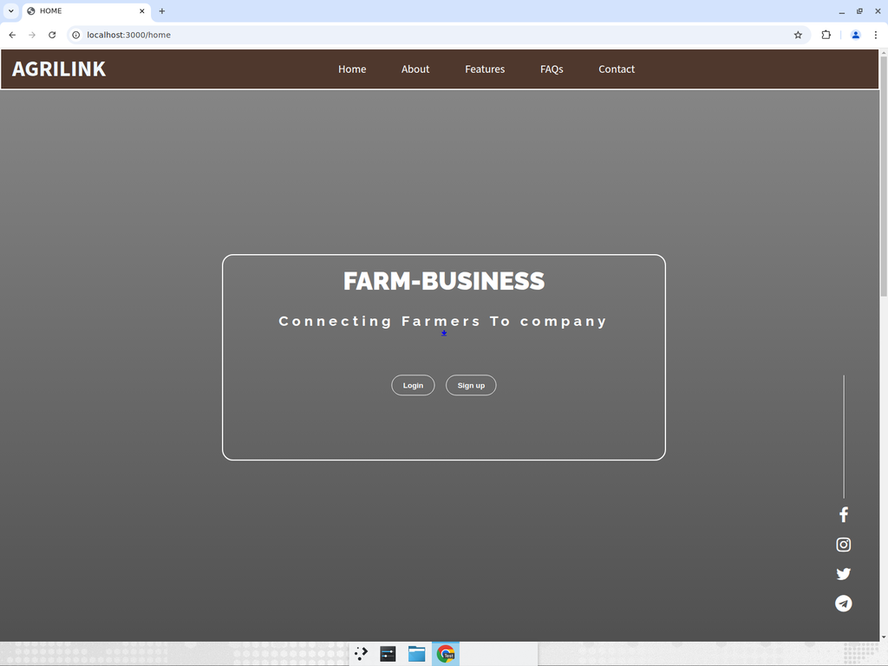
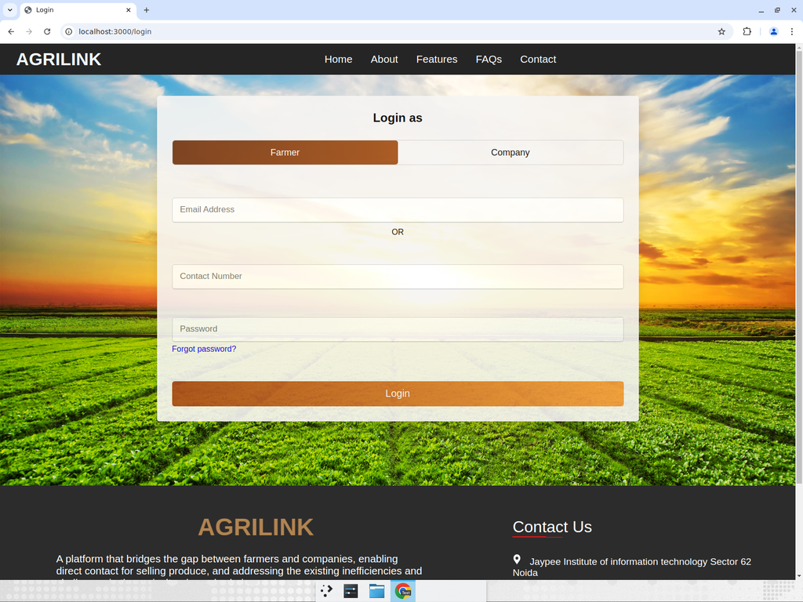
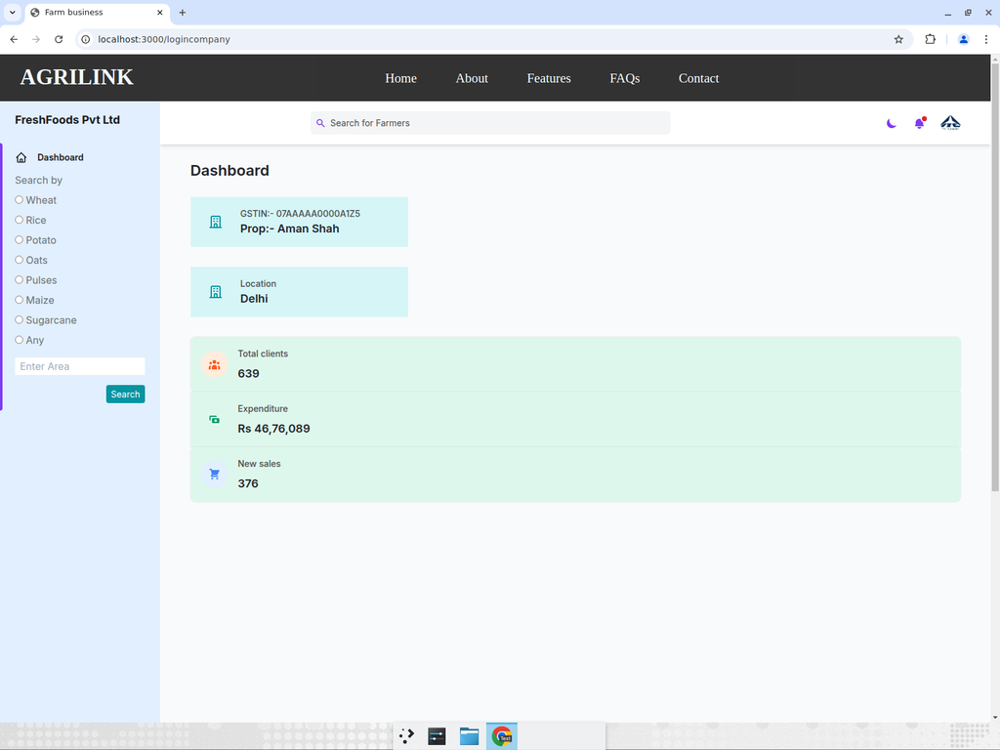
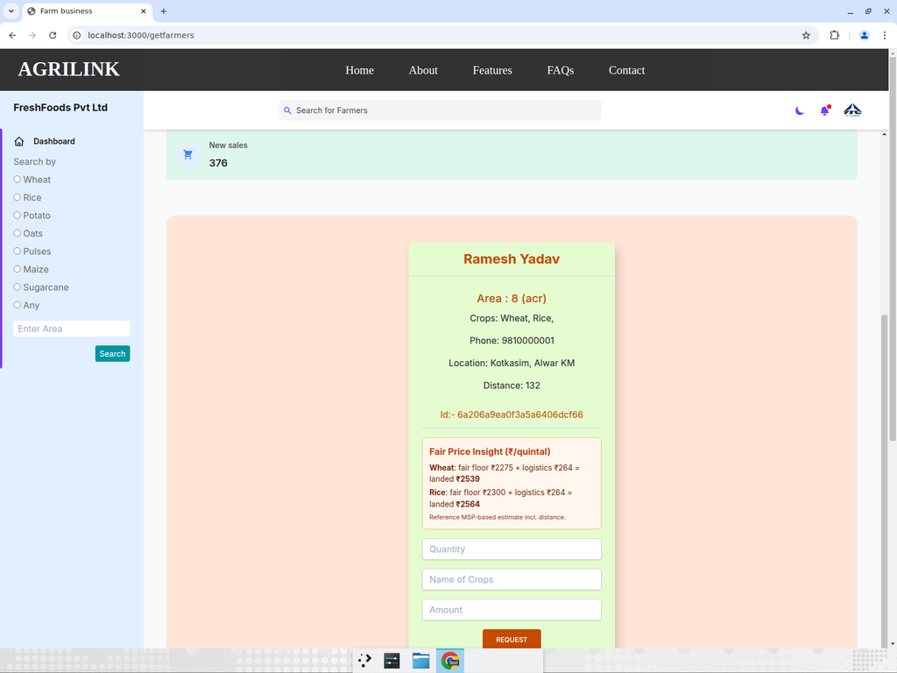

# AgriLink 🌾

[](https://github.com/kush300304/AgriLink/actions/workflows/ci.yml)
[](https://nodejs.org/)
[](LICENSE)

**AgriLink is a marketplace that connects farmers directly with verified buyers — and helps both sides agree on a _fair_ price.**

Traditional agricultural supply chains push produce through layers of middlemen, leaving farmers with a fraction of the final price. AgriLink removes that gap: buyers (companies) search for farmers by crop and land size, and every farmer card shows a transparent **Fair Price Insight** — an MSP-based floor price plus a distance-based logistics estimate — so orders are placed on fair, explainable terms.

> Live demo (legacy deployment): https://agrilink-j2f4.onrender.com

---

## Table of contents

- [Features](#features)
- [Fair Price Insight](#fair-price-insight-the-core-idea)
- [Screenshots](#screenshots)
- [Architecture](#architecture)
- [Tech stack](#tech-stack)
- [Getting started](#getting-started)
- [Environment variables](#environment-variables)
- [API reference](#api-reference)
- [Testing](#testing)
- [Project structure](#project-structure)
- [Security notes](#security-notes)
- [License](#license)

---

## Features

- **Two account types** — Farmers list their produce; Companies (buyers) browse and order.
- **JWT cookie authentication** — Stateless, `httpOnly`-cookie based auth for both roles, with role-aware route protection.
- **Search & filter** — Buyers find farmers by crop keyword and minimum land area, with pagination.
- **Fair Price Insight** ✨ — A transparent, MSP-based fair-price estimate (incl. buyer→farmer logistics) shown on every farmer card and exposed as an API.
- **Order placement** — Companies send purchase requests that are recorded against both the farmer and the buyer.
- **Hardened backend** — `helmet` security headers, centralized error handling, hashed passwords (`bcrypt`), and secrets kept out of source control.
- **Tested & linted** — Jest + Supertest suite running on an in-memory MongoDB (no external DB needed), ESLint + Prettier, and GitHub Actions CI.

## Fair Price Insight (the core idea)

AgriLink's mission is "justified prices" for farmers. The [`pricing`](backend/utils/pricing.js) module turns that into a concrete number:

```
buyerLandedPrice = farmerFloorPrice(MSP)  +  (distanceKm × logisticsRatePerKm)
```

- **`farmerFloorPrice`** — a reference Minimum Support Price (₹/quintal) per crop, so farmers always see a fair floor.
- **logistics** — a distance-based cost (₹/km/quintal) between the buyer's hub and the farmer, so buyers see the true landed cost.

It's a pure, fully unit-tested function and is surfaced both in the buyer dashboard and via `GET /api/v1/price`.

## Screenshots

| Landing                            | Login (role-aware)                   |
| ---------------------------------- | ------------------------------------ |
|  |  |

| Buyer dashboard                                      | Fair Price Insight on a farmer card                            |
| ---------------------------------------------------- | -------------------------------------------------------------- |
|  |  |

## Architecture

AgriLink is a server-rendered Express app (EJS) with a small JSON API. The web layer and the API share a single **service layer** so business logic lives in exactly one place.

```
                       ┌─────────────────────────────────────────┐
   Browser  ──────────▶│  Express (app.js)                        │
   (EJS UI)            │   • helmet, cookie-parser, body-parser   │
                       │   • attachUser (JWT cookie → req.user)   │
                       └───────────────┬─────────────────────────┘
                                       │
                 ┌─────────────────────┼──────────────────────┐
                 ▼                     ▼                      ▼
        Web routes (EJS)        API routes (/api/v1)     Fair Price util
        /login /getfarmers      /farmer /company /price  (pure functions)
                 │                     │
                 └──────────┬──────────┘
                            ▼
                    Service layer  ── farmerService / companyService
                            ▼
                    Mongoose models  ── Farmer / Company  ──▶  MongoDB
```

Key design decisions:

- **No self-HTTP calls.** The previous version called its own REST API over `http://127.0.0.1:3000` from within the same process; the web layer now calls the service layer directly.
- **No global session state.** Logged-in users were previously stored in module-level globals (so every visitor shared one session). Auth is now a signed JWT in an `httpOnly` cookie carrying the user's `id` and `role`.

## Tech stack

- **Runtime:** Node.js (>= 18)
- **Server:** Express, EJS views
- **Database:** MongoDB via Mongoose
- **Auth:** JSON Web Tokens (`jsonwebtoken`) + `bcryptjs`, cookie-based
- **Security:** Helmet
- **Tooling:** Jest, Supertest, `mongodb-memory-server`, ESLint, Prettier, GitHub Actions

## Getting started

### Prerequisites

- Node.js >= 18 (an [`.nvmrc`](.nvmrc) is provided — run `nvm use`)
- A MongoDB instance (local `mongod`, Docker, or MongoDB Atlas)

### Install

```bash
git clone https://github.com/kush300304/AgriLink.git
cd AgriLink
npm install
```

### Configure

```bash
cp backend/config/config.env.example backend/config/config.env
# then edit backend/config/config.env with your values
```

### Run

```bash
npm run dev     # start with nodemon (auto-reload)
npm start       # start normally
```

The app serves on `http://localhost:3000`.

> **Tip:** to try it without installing MongoDB, point `DB_URI` at any MongoDB instance (e.g. a free Atlas cluster), or run `mongod` locally on `mongodb://127.0.0.1:27017/agrilink`.

## Environment variables

All configuration lives in `backend/config/config.env` (gitignored). See [`config.env.example`](backend/config/config.env.example).

| Variable              | Description                                   | Example                              |
| --------------------- | --------------------------------------------- | ------------------------------------ |
| `PORT`                | Port the server listens on                    | `3000`                               |
| `NODE_ENV`            | `DEVELOPMENT` or `PRODUCTION`                 | `DEVELOPMENT`                        |
| `DB_URI`              | MongoDB connection string                     | `mongodb://127.0.0.1:27017/agrilink` |
| `JWT_SECRET`          | Secret used to sign JWTs (long random string) | `a_long_random_secret`               |
| `JWT_EXPIRES_TIME`    | JWT lifetime                                  | `7d`                                 |
| `COOKIE_EXPIRES_TIME` | Auth cookie lifetime, in days                 | `7`                                  |

## API reference

Base path: `/api/v1`

| Method  | Endpoint            | Auth    | Description                                                   |
| ------- | ------------------- | ------- | ------------------------------------------------------------- |
| `POST`  | `/farmer/register`  | —       | Register a farmer; returns a JWT + sets the auth cookie       |
| `POST`  | `/farmer/login`     | —       | Log a farmer in (by `email` **or** `contactNo` + `password`)  |
| `GET`   | `/farmer`           | —       | List/search farmers (`?keyword=Wheat&land[gte]=5&page=1`)     |
| `PATCH` | `/farmer/order/:id` | Company | Add an order to a farmer                                      |
| `POST`  | `/company/register` | —       | Register a company; returns a JWT + sets the auth cookie      |
| `POST`  | `/company/login`    | —       | Log a company in                                              |
| `GET`   | `/price`            | —       | Fair-price estimate (`?crop=Wheat&quantity=10&distanceKm=58`) |

Example:

```bash
curl "http://localhost:3000/api/v1/price?crop=Wheat&quantity=10&distanceKm=58"
```

```json
{
  "success": true,
  "estimate": {
    "crop": "Wheat",
    "quantity": 10,
    "distanceKm": 58,
    "currency": "INR",
    "unit": "quintal",
    "farmerFloorPerQuintal": 2275,
    "logisticsPerQuintal": 116,
    "buyerLandedPerQuintal": 2391,
    "farmerFloorTotal": 22750,
    "logisticsTotal": 1160,
    "buyerLandedTotal": 23910
  }
}
```

## Testing

The suite uses Jest + Supertest against an **in-memory MongoDB** — no external database required.

```bash
npm test              # run all tests
npm run test:coverage # run with coverage
npm run lint          # ESLint
npm run format:check  # Prettier
```

Coverage includes the pricing module (unit), and the farmer/company/price endpoints (integration: registration, login, password hashing, auth-protected routes, search/filter, and fair-price estimation).

## Project structure

```
AgriLink/
├── app.js                     # Express app: middleware, routes, view wiring
├── server.js                  # Entry point: config + DB connect + listen
├── backend/
│   ├── config/                # config.env (gitignored) + example + DB connect
│   ├── controllers/           # Thin HTTP handlers (farmer, company, price)
│   ├── services/              # Business logic (farmerService, companyService)
│   ├── middlewares/           # auth (JWT cookie), error handling, asyncwrap
│   ├── models/                # Mongoose schemas (Farmer, Company)
│   └── utils/                 # auth, pricing (Fair Price Insight), apiFeatures
├── views/                     # EJS templates
├── public/                    # Static assets
├── tests/                     # Jest + Supertest suite (in-memory MongoDB)
└── .github/workflows/ci.yml   # Lint + format + test on Node 18 & 20
```

## Security notes

- Secrets are **never** committed — `backend/config/config.env` is gitignored; use the provided `.example`.
- Passwords are hashed with `bcrypt`; the password field is excluded from query results by default and never returned by the API.
- Auth tokens are stored in `httpOnly` cookies and signed with `JWT_SECRET`.

> If you previously committed real credentials to this repo's history, **rotate them** (database password and `JWT_SECRET`).

## License

[MIT](LICENSE) © Kushal Garg
